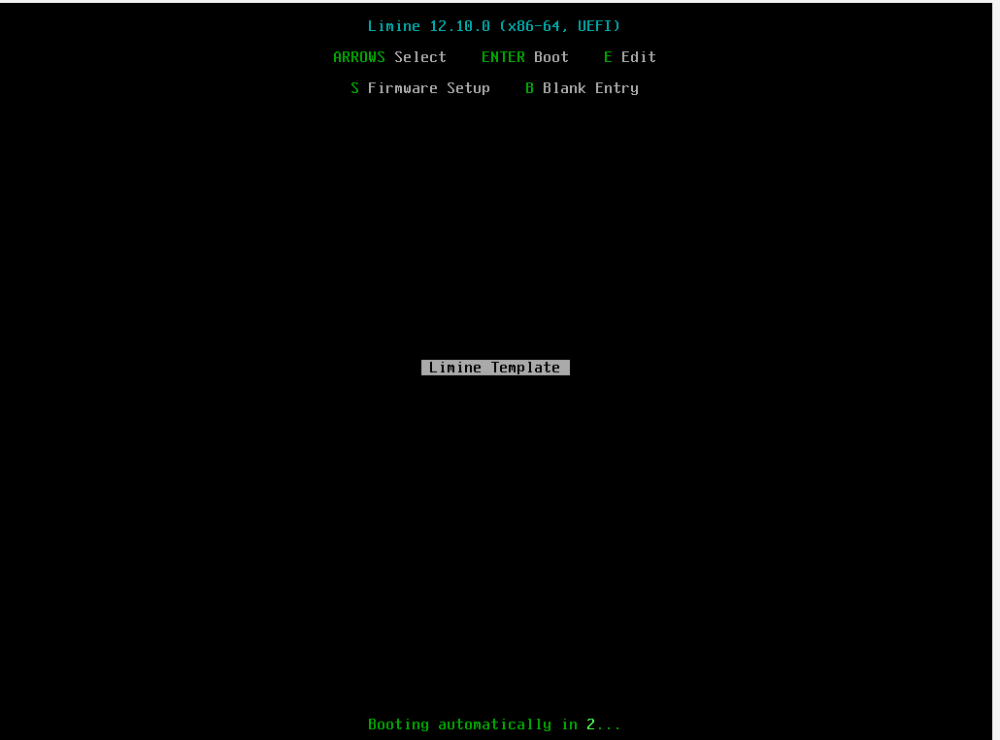

# eL-Kernel

**A hobby operating system kernel written in C for x86-64 architecture.**

eL-Kernel is a learning-oriented kernel development project built using C and the [Limine](https://github.com/limine-bootloader/limine) bootloader. The project focuses on understanding low-level system programming, kernel development, framebuffer graphics and operating system fundamentals.

## Current Progress

### First successful boot

successfully booting inside Oracle VirtualBox using the Limine bootloader.



eL-Kernel successfully booting inside Oracle VirtualBox using the Limine bootloader.


**Boot configuration:** x86-64 · UEFI · 1024 × 768 framebuffer

## Features

- **64-bit kernel:** Built for the x86-64 architecture.
- **Limine bootloader:** Uses the Limine boot protocol.
- **Framebuffer support:** Initializes and accesses the framebuffer provided by Limine.
- **Text terminal:** Custom framebuffer-based text rendering using a 5×7 bitmap font.
- **Terminal scrolling:** Basic line wrapping and scrolling.
- **`kprintf`:** A custom formatted output function.

### Supported `kprintf` format specifiers

| Specifier | Description |
|---|---|
| `%c` | Character |
| `%s` | String |
| `%d` | Signed integer |
| `%u` | Unsigned integer |
| `%x` | Hexadecimal |
| `%%` | Literal percent sign |

## Project Structure

```text
eL-Kernel/
├── images/
│   └── vbelkernel.png
├── kernel/
│   ├── src/
│   │   ├── main.c
│   │   ├── memory.c
│   │   ├── memory.h
│   │   ├── terminal.c
│   │   ├── terminal.h
│   │   ├── kprintf.c
│   │   └── kprintf.h
│   ├── GNUmakefile
│   └── get-deps
├── GNUmakefile
├── limine.conf
└── README.md
```

## Development Environment

The project is currently developed and tested using:

- Windows 11
- MSYS2 UCRT64
- GCC x86_64-elf cross-compiler
- GNU Make
- Oracle VirtualBox
- Limine bootloader

## Building

Clone the repository:

```bash
git clone https://github.com/lyashwith/eL-Kernel.git
cd eL-Kernel
```

Run the build from an environment with the required cross-compilation toolchain and dependencies installed:

```bash
make TOOLCHAIN_PREFIX=x86_64-elf-
```

The build produces:

```text
template.iso
```

The ISO can be attached to a virtual machine in Oracle VirtualBox for testing.

## Testing

The kernel has successfully booted in Oracle VirtualBox with:

- UEFI boot enabled
- 64-bit execution
- 1024 × 768 framebuffer
- Custom text terminal output

## Roadmap

- [x] Initial Limine integration
- [x] 64-bit kernel boot
- [x] Framebuffer initialization
- [x] Basic framebuffer terminal
- [x] Custom `kprintf` implementation
- [ ] Improve bitmap font and character support
- [ ] Add keyboard input
- [ ] Improve terminal functionality
- [ ] Develop memory management
- [ ] Explore interrupt handling
- [ ] Expand kernel functionality

## Project Goals

The goal of eL-Kernel is to learn and experiment with operating system development from the ground up, gradually implementing the fundamental components of a kernel.

This is an ongoing educational hobby project. Features and architecture may change as development progresses.

## License

Refer to the repository's license file for licensing information.
